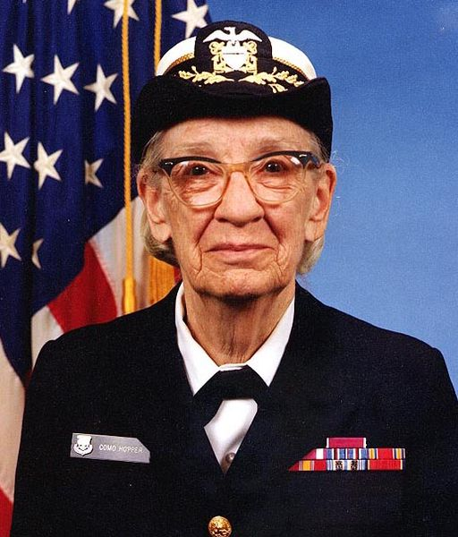
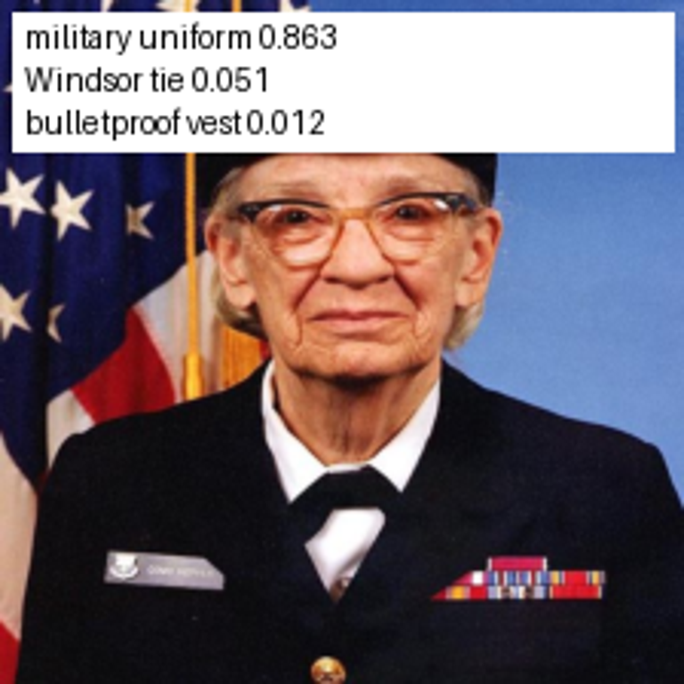

# Demo D2-11 — MobileNet V1 na CPU, GPU e HTP v68

Ensaio na QB560D-EU/QCM6490 em 31/10/2026, horário de São Paulo. As evidências usam UTC (`20261101...`).

**Revalidação em 01/11/2026 no firmware com login:** BSP `QDPA_Ubuntu20.04.003.51.303 V01`, kernel build 02/04/2026, glibc **2.31**, payload persistente em `/opt/qb560d-training-payload`. As 12 sessões passaram novamente. No mesmo DLC: CPU fixed point **6,701 ms**, HTP **1,109 ms**, razão **6,04×**. O profile confirmou 34 entradas DSP e zero CPU. TFLite CPU/GPU nessa rodada: 25,994/9,786 ms. [Novo resumo](../evidence/htp-dsp/20261101T173204Z/summary.json). As tabelas de 31/10 abaixo preservam o ensaio anterior; os comandos de reprodução já usam o fluxo atual.

## Objetivo, algoritmo e tipo de inferência

Demonstrar a classificação local de uma imagem na AI Box e comparar a execução em CPU, GPU e HTP, verificando tanto as saídas quanto o processador que executou o grafo.

| Item | Configuração da demo |
|---|---|
| Algoritmo | **MobileNet V1 1.0, entrada 224×224**, rede neural convolucional de visão computacional |
| Arquitetura | Convoluções separáveis em profundidade (*depthwise separable convolutions*), próprias para reduzir o custo de processamento da rede |
| Tarefa | Classificação multiclasse da imagem inteira, com ranking das classes por score |
| Tipo de inferência | Local no dispositivo (*edge inference*), síncrona, imagem estática, lote de uma imagem (`batch=1`), pesos pré-treinados fixos |
| Vocabulário da saída | 1001 posições: `background` e 1000 classes ImageNet, conforme `models/imagenet_labels.txt` |
| Modelo de origem | TFLite quantizado em 8 bits, `models/mobilenet_v1.tflite`, pacote TensorFlow `mobilenet_v1_1.0_224_quant` |
| Modelo CPU/HTP | Conversão do mesmo modelo para `models/mobilenet_v1_snpe_int8.dlc`: pesos/ativações de 8 bits e bias de 32 bits |
| Entrada TFLite | RGB uint8 `[1,224,224,3]`, escala 1/128, zero point 128 |
| Entrada SNPE | ITensor float32 NHWC `[1,224,224,3]`, valores `(RGB - 128) / 128`; execução quantizada no DLC |
| Saída | 1001 scores; TFLite uint8 desquantizado por 1/256, SNPE com valores float32 expostos pela API |
| Pós-processamento | Ordenar os scores, mapear os índices para os rótulos e mostrar os três maiores valores (`top-3`) |

A arquitetura está descrita no [artigo original MobileNets](https://arxiv.org/abs/1704.04861). A origem exata dos pesos usados nesta demo está fixada em [models.lock.json](../models/models.lock.json); não foi feito treinamento ou ajuste dos pesos durante o ensaio. A quantização/conversão foi feita no computador, e a inferência foi executada no target.

O resultado representa uma classe visual para a imagem inteira. Identificação de pessoas, localização por caixas, segmentação e processamento contínuo de vídeo estão fora deste ensaio. O arquivo TFLite é quantizado, mas a utilização do delegate GPU/OpenCL não comprova aritmética INT8 nativa na GPU.

## Ambiente testado

| Componente | Versão ou condição observada |
|---|---|
| Target | Quectel QB560D-EU, SoC Qualcomm QCM6490, acesso ADB |
| Sistema | Ubuntu 20.04.3 LTS, AArch64, kernel `5.4.219-perf` |
| Python do target | 3.8.10, NumPy existente e Pillow 10.4.0 em dependência isolada |
| CPU/GPU TFLite | Biblioteca do BSP `/usr/lib/libtensorflowlite_c.so`, versão 2.8.4; GPU com delegate OpenCL |
| CPU/HTP SNPE | Runtime `2.26.0.240827110523_99241`, conjunto Ubuntu gcc9.4 do SDK 2.26.0.240828 |
| Aceleração HTP | HTP v68, runtime `DSP_FIXED8_TF`, unsigned PD, em processo isolado |
| Local de execução atual | `/opt/qb560d-training-payload`, com bibliotecas SNPE em `runtime/qairt226-ubuntu`; medições históricas podem registrar o caminho anterior em `/tmp` |
| Computador de preparação | Windows, Python e ADB; conversão feita com Python 3.8 x64 e ferramentas Windows do SDK |

## Imagem analisada e resultado de classificação

Foi analisado o arquivo **`media/grace_hopper.jpg`**, retrato de uma pessoa usando uniforme naval, disponibilizado no bucket de exemplos do TensorFlow. A origem está em [media/sources.json](../media/sources.json). A imagem original tem **512×600 pixels**.



O pré-processamento aplica a orientação EXIF, converte para RGB e redimensiona diretamente para **224×224 com interpolação bilinear**, sem recorte ou preservação da proporção. O lote contém uma imagem. Para o SNPE, os pixels são convertidos para float32 e normalizados por `(pixel - 128) / 128`.

Na execução HTP, o ranking foi:

| Posição | Índice no vetor de saída | Rótulo retornado | Interpretação em português | Score |
|---|---:|---|---|---:|
| 1 | 653 | `military uniform` | uniforme militar | **0,86328125 — 86,33%** |
| 2 | 907 | `Windsor tie` | gravata Windsor | 0,05078125 — 5,08% |
| 3 | 466 | `bulletproof vest` | colete à prova de balas | 0,01171875 — 1,17% |

Os índices acima usam a lista local que inclui `background` no índice 0. São alternativas de classificação global; o terceiro rótulo não comprova que exista um colete na imagem. O primeiro rótulo é coerente com o uniforme visível. **86,33% é o score retornado pelo modelo nessa imagem, não uma acurácia medida de 86,33%**, nem uma probabilidade calibrada demonstrada pelo ensaio.



Os valores exatos estão no [result.json da sessão HTP](../evidence/htp-dsp/20261101T021205Z/target/session_1_htp/result.json). A mesma classe principal foi obtida em todas as sessões CPU, GPU e HTP.

## O que foi testado

| Verificação | Procedimento realizado | Resultado e evidência |
|---|---|---|
| TFLite em CPU | Três sessões, mesma imagem e modelo; duas threads | Passou; classe 653 em todas as sessões |
| TFLite em GPU | Três sessões com delegate GPU; logs exigem OpenCL e criação de kernel delegado | Passou; uma partição GPU confirmada; classe 653 |
| DLC em CPU | Três sessões do DLC quantizado com `--cpu-fixed-point` | Passou; controle CPU do mesmo arquivo usado pelo HTP |
| DLC em HTP/DSP | Três sessões, ordem de runtime contendo somente DSP, sem nova tentativa em CPU | Passou; classe 653; `runtime_order: ["dsp"]`, `cpu_retry: false` |
| Tempo de inferência | 50 chamadas medidas após dez aquecimentos por sessão; ordem dos backends alternada entre sessões | 12 sessões, **600 inferências medidas e 120 aquecimentos**, com profiling desligado |
| Localização das operações | Uma execução HTP adicional, uma inferência, zero aquecimentos e profiling detalhado | **34 entradas DSP / zero CPU**, incluindo entrada e saída; 32 operações de computação |
| Integridade da comparação | Hashes de modelos e da imagem; formato e finitude dos 1001 valores de saída | Passou; TFLite CPU/GPU compartilham um hash, CPU DLC/HTP compartilham outro |
| Diferença numérica | Comparação do vetor completo, além do top-1 | Classe principal igual; diferenças de scores quantificadas abaixo |
| Conversão do modelo | ONNX comparado ao TFLite de origem no TensorFlow 2.13, antes/depois do ajuste de metadados de eixo | Saídas exatamente iguais na imagem fornecida |
| Reconstrução do DLC | Receita executada novamente; candidato validado uma vez em CPU e uma vez em HTP | Saídas exatamente iguais às do DLC publicado nessa imagem; arquivos têm hashes diferentes |
| Tentativa TFLite Hexagon | Inicialização do delegate DSP antigo do BSP | Falhou antes da inferência; histórico preservado, sem usar CPU como substituto |

O resumo das 12 sessões é [summary.json](../evidence/htp-dsp/20261101T021205Z/summary.json). A conferência da reconstrução está em [conversion/rebuild.json](../evidence/htp-dsp/20261101T021205Z/conversion/rebuild.json). Os testes de sintaxe e os 14 testes unitários/HTTP do pacote também passaram, conforme [software-qa.json](../evidence/software-qa.json); eles complementam os ensaios reais de inferência descritos nesta tabela.

## Resultado confirmado

A mesma MobileNet V1 do treinamento foi convertida do TFLite original para um **DLC INT8 separado** e executada no HTP v68. Usamos componentes do [SDK público Qualcomm 2.26.0.240828](https://softwarecenter.qualcomm.com/api/download/software/qualcomm_neural_processing_sdk/v2.26.0.240828.zip), sem precisar receber um pacote da Quectel. O runtime ficou em uma pasta privada temporária, preservando o BSP.

| Execução | Mediana das medianas de três sessões | Top-1 / score |
|---|---:|---|
| TFLite CPU, 2 threads | 25,565 ms | military uniform / 0,88671875 |
| TFLite GPU, OpenCL do BSP | 10,324 ms | military uniform / 0,88281250 |
| SNPE CPU fixed point, DLC INT8 | 6,748 ms | military uniform / 0,87890625 |
| SNPE HTP v68, mesmo DLC INT8 | **1,130 ms** | military uniform / 0,86328125 |

Comparação principal: **5,97×** entre CPU fixed point e HTP, usando exatamente o mesmo DLC e entrada. A razão TFLite CPU/HTP é 22,63×, mas combina runtime, formato e quantização diferentes; não representa um ganho isolado de hardware. O TFLite usa duas threads; a CPU SNPE usa a política padrão do runtime.

Cada backend teve três sessões de 50 inferências após dez aquecimentos. Medimos somente `InterpreterInvoke`/`ExecuteITensors`, sem pré-processamento, cópia de saída, renderização, compilação ou ADB. Profiling desligado no benchmark; uma execução separada coletou o profile detalhado.

O profile apresenta **34 entradas DSP e zero entradas CPU**, incluindo entrada/saída do grafo, com 32 operações de computação. O código solicita apenas `DSP_FIXED8_TF`, unsigned PD, e não tenta CPU novamente se falhar. Preparação da imagem e controle Python continuam na CPU.

## Precisão e limites

- Top-1 coincidiu em todas as sessões, na imagem fornecida.
- Maior diferença absoluta de probabilidade HTP versus CPU do mesmo DLC: **0,015625 (4/256)**.
- HTP versus TFLite CPU do BSP: **0,0234375 (6/256)**.
- GPU versus TFLite CPU: 1/256; CPU DLC versus TFLite CPU: 2/256.
- ONNX e TFLite original no TensorFlow 2.13 produziram saídas exatamente iguais nessa imagem, inclusive após o ajuste de metadados de eixo. O TensorFlow 2.13 e o TFLite 2.8.4 do BSP já diferem em 3/256 na referência.

Essas diferenças de aritmética e quantização são reais. A demo passou como **validação funcional da imagem de referência**, sem promessa de equivalência bit a bit nem de acurácia em dataset. As duas imagens de calibração não constituem validação de precisão. Para produto, medir acurácia e latência completa com dados representativos.

## Preparar e repetir

### 1. Conferir os pré-requisitos

Abra o PowerShell na raiz `training_v2`. É necessário Python com NumPy no computador, uma única QB560D autorizada por ADB e os arquivos do pacote `training_v2`. O ADB é descoberto no pacote Docker ou no PATH. Os helpers fazem login root e pedem a senha sem eco. Com várias caixas, informe o `--transport-id` atual.

```powershell
$py = (Resolve-Path provision_target/.venv/Scripts/python.exe).Path
& $py --version
& $py -c "import numpy; print(numpy.__version__)"
& $py host/adb_lab.py inventory
```

O ZIP atualizado inclui os nove arquivos fixados em `offline/snpe226`, com licença, quatro bibliotecas ARM64 e decoder Windows. Não é necessário baixar o SDK para repetir esta demo. A inferência funciona localmente, sem conta AI Hub ou conexão com a nuvem. A [WLAN](WLAN.md) é útil para outros exercícios; a transferência desta demo usa ADB.

### 2. Enviar o material e preparar o target

```powershell
& $py host/adb_lab.py push
& $py host/adb_lab.py run ai prepare
```

`push` envia scripts, modelos, imagens e o wheel para `/opt/qb560d-training-payload`. `ai prepare` extrai o Pillow isolado quando ausente ou verifica os arquivos fixados já existentes. O diretório privado preparado por `provision_target` pode ser reutilizado; diferenças ou conteúdo incompleto são recusados.

### 3. Obter e enviar o runtime HTP correspondente

```powershell
& $py host/stage_snpe_runtime.py --check-only
& $py host/stage_snpe_runtime.py
```

Os comandos usam primeiro `offline/snpe226` e conferem `host/snpe-runtime.lock.json`. Para reconstruir esse cache no computador de preparação, `fetch_snpe_sdk.py --mode demo` continua disponível; ele lê os membros selecionados do ZIP oficial por HTTP Range e confere CRC/SHA-256. O cache anterior em `.build` é uma alternativa; não é exigido pelo ZIP atual. `--sdk-root` permite selecionar outro cache completo correspondente ao lock.

As quatro bibliotecas ficam em `/opt/qb560d-training-payload/runtime/qairt226-ubuntu/`:

- `lib/aarch64-ubuntu-gcc9.4/libSNPE.so`
- `lib/aarch64-ubuntu-gcc9.4/libSnpeHtpV68Stub.so`
- `lib/aarch64-ubuntu-gcc9.4/libSnpeHtpPrepare.so`
- `lib/hexagon-v68/unsigned/libSnpeHtpV68Skel.so`

O staging verifica também os hashes remotos. O conjunto Ubuntu gcc9.4 funcionou com a glibc **2.31**, medida por `getconf GNU_LIBC_VERSION`. A indicação antiga 2.29 veio de identificação do Python e não representa a glibc do BSP. O runtime informa `2.26.0.240827110523_99241`. Não misture stub/skel com SNPE 2.12/2.21 instalado. `libSnpeHtpPrepare.so` é necessário; `libQnnHtpPrepare.so` não o substitui.

### 4. Executar a comparação completa recomendada

```powershell
& $py host/run_htp_comparison.py
```

O coletor alterna a ordem, confere hashes e os 1001 valores de saída, exige top-1 correspondente e registra as diferenças numéricas. Exige OpenCL nos logs GPU e somente DSP nas entradas do profile HTP. Salva nova evidência sem apagar sessões anteriores e atualiza `evidence/htp-dsp/LATEST.json`. A decodificação automática usa o executável Windows do SDK.

### 5. Apresentar somente a demo HTP ou o controle CPU

Crie uma identificação de sessão para evitar sobrescrever resultados e execute no PowerShell:

```powershell
$demoStamp = Get-Date -Format "yyyyMMdd-HHmmss"
& $py host/adb_lab.py run ai snpe --sdk-root runtime/qairt226-ubuntu --model models/mobilenet_v1_snpe_int8.dlc --image media/grace_hopper.jpg --backend dsp --input-mode normalized --runs 50 --warmup 10 --profiling off --output "evidence/htp-live-$demoStamp"
& $py host/adb_lab.py run ai snpe --sdk-root runtime/qairt226-ubuntu --model models/mobilenet_v1_snpe_int8.dlc --image media/grace_hopper.jpg --backend cpu --cpu-fixed-point --input-mode normalized --runs 50 --warmup 10 --profiling off --output "evidence/cpu-dlc-live-$demoStamp"
```

Esses dois comandos medem inferência com profiling desligado. Para comprovar a localização das operações em uma nova sessão, prefira o coletor da etapa 4: ele faz um ensaio adicional com `--profiling detailed`, decodifica o DiagLog e exige entradas somente DSP. Os mesmos argumentos da execução manual funcionam diretamente no target com `sh target/ai.sh snpe ...`, dentro de `/opt/qb560d-training-payload`.

### 6. Coletar e conferir os resultados

O coletor completo da etapa 4 já faz o download automático para `evidence/htp-dsp/<UTC>/`. Para as execuções manuais:

```powershell
& $py host/adb_lab.py pull
```

O material é copiado para uma pasta nova `evidence/<UTC>-target/`, com as subpastas de evidência do target. Na pasta de cada execução SNPE, confira:

| Arquivo | Conteúdo e conferência |
|---|---|
| `result.json` | Modelo/imagem por hash, runtime, shape, top-3, tempos; HTP deve mostrar `backend_requested: "dsp"`, `runtime_order: ["dsp"]` e `cpu_retry: false` |
| `outputs.npz` | Vetor completo de scores para comparação numérica |
| `classification.png` | Imagem redimensionada e anotada com o top-3 |
| `SNPEDiag_0.log` | Profile binário gerado quando profiling está habilitado; decodificado pelo coletor completo |

No ensaio completo, `summary.json` deve registrar `PASS_REFERENCE_IMAGE_HTP`, os hashes correspondentes, top-1 igual e as diferenças numéricas. `htp-profile.txt` deve confirmar o grafo em DSP, sem entradas CPU. A imagem de referência deve produzir a classe 653 (`military uniform`); os scores e tempos podem variar conforme runtime e estado térmico/carga da caixa. A latência observada anteriormente é uma referência, não um limite garantido de aprovação.

O caminho atual em `/opt` persiste após reinício. Se escolher `--remote /tmp/qb560d-training`, use esse argumento também no staging e no comparador e repita o envio após reboot. Não coloque bibliotecas em `/data` nesta imagem: foi observado com `noexec`. A configuração persistente de WLAN está no [guia WLAN](WLAN.md). Um cold boot físico com persistência e reconexão WLAN foi aprovado; consulte [BOOT_WLAN.md](BOOT_WLAN.md) para a evidência e os limites da rodada.

## Origem e reconstrução do modelo

O TFLite original permanece intacto:

- `models/mobilenet_v1.tflite`: SHA-256 `ecc3a67c47c5a609ec35f6a58a7d97532834e43df4cb7d3f1204a8164b7d20dd`.
- `models/mobilenet_v1_snpe_int8.dlc`: SHA-256 `7890590e120f7a361643e06f51c12935b9890b660d261c382ee1bf302d97a359`.
- [Proveniência e flags](../models/snpe-model.origin.json).
- Imagem `media/grace_hopper.jpg`: SHA-256 `a8ca6d734765703b09728ab47fe59f473d93ae3967fc24c7c0288c3c7adb7130`.

A reconstrução ocorre no computador Windows, sem instalar TensorFlow ou conversor no target. Prepare o Python 3.8 portátil e a venv local conforme a [seção de ambientes do guia manual](TFLITE_PARA_HTP_PASSO_A_PASSO.md#1-ambientes-e-pasta-de-trabalho); o pacote oficial CPython NuGet acompanha o treinamento em `tools/python38`, sem instalar Python no Windows. Depois, a partir de `training_v2`:

```powershell
$exporter = (Resolve-Path .build/manual-export-py38/Scripts/python.exe).Path
$py = (Resolve-Path provision_target/.venv/Scripts/python.exe).Path
& $exporter -m pip install -r host/requirements-snpe-conversion.txt
& $py host/fetch_snpe_sdk.py --mode conversion
& $exporter host/rebuild_snpe_model.py
```

O script salva um **candidato novo** em `.build/snpe-conversion-rebuilt`, recusa sobrescrever pasta existente e não publica o DLC automaticamente. Use `--output` para escolher outra pasta. A evidência histórica de reconstrução com o ambiente privado antigo permanece preservada.

**Validação adicional em 05/11/2026:** o bloco acima foi executado com venvs novas criadas a partir dos pacotes oficiais CPython NuGet portáteis 3.8.10 e 3.12.10, em uma cópia curta dos arquivos do ZIP. Não foi necessário Python 3.8 instalado no Windows. Foram executados `pip install`, `fetch_snpe_sdk.py --mode conversion` e `rebuild_snpe_model.py`. O ONNX coincidiu exatamente com o TFLite TF2.13 na imagem de referência. O novo DLC teve os mesmos 1.001 scores do publicado, tanto em CPU-fixed quanto em HTP: diferença absoluta máxima **0,0** em cada backend. O profile separado confirmou **34 entradas DSP / zero CPU**, sem tentativa de CPU na execução HTP. Os hashes de 48 arquivos dos modelos/runtimes da caixa e os pacotes da venv principal existente permaneceram iguais. Consulte o [recibo da preparação portátil](../evidence/demo-regression/20261105T123847Z/release/SNPE_FRESH_VENV.json) e o [profile decodificado](../evidence/demo-regression/20261105T123847Z/snpe-fresh-venv/htp-profile.txt). Esse teste é do fluxo **SNPE 2.26 INT8** desta seção; o capítulo manual QAIRT 2.51 w8a16 mantém sua evidência própria.

Pipeline implementado e executado:

1. `tf2onnx 1.16.1`, opset 13, preservando QuantizeLinear/DequantizeLinear. Não usar `--dequantize` neste caminho.
2. Explicitar `axis=0` em 28 biases de rank 1 com escala escalar. O eixo não altera a matemática escalar; evita que o frontend use eixo 1 inválido. Shape inference e ONNX checker passam; comparação exata TFLite TF2.13/ONNX é obrigatória.
3. `snpe-onnx-to-dlc --input_layout input NHWC --input_dtype input float32 -n --strict`. `-n` desativa simplificação. Pode ocorrer aviso de subprocesso de shape inference no Windows; os shapes já foram inferidos e conferidos antes da conversão estrita.
4. Calibração RGB/BILINEAR 224×224 com `grace_hopper.jpg` e `right_hands.jpg`. Raw float32 NHWC: **`(pixels - 128) / 128`**. Lista com caminhos relativos para suportar espaços no diretório.
5. `snpe-dlc-quant --weights_bitwidth 8 --act_bitwidth 8 --bias_bitwidth 32 --override_params`, preservando os encodings fornecidos pelo modelo de origem.

O DLC expõe entrada float32 `[1,224,224,3]`; não copie bytes uint8 diretamente para ITensor. O controle CPU requer `--cpu-fixed-point`. Não use o DLC intermediário float como referência sem validar o efeito de remover os encodings/clamps de quantização.

## Diagnóstico anterior preservado

O delegate Hexagon NN do TFLite 2.8.4 falhou com `Failed to fetch Hexagon NN version`. A solução funcional é SNPE/HTP. O SNPE 2.12 instalado passou no probe unsigned PD, mas não executou o DLC novo: o builder reportou rede vazia. Disponibilidade de runtime e compatibilidade de modelo são verificações distintas.

Os paths (`LD_LIBRARY_PATH`, `ADSP_LIBRARY_PATH`) e unsigned PD são privados ao processo. Não houve troca de firmware, bibliotecas globais, glibc, BSP ou build Yocto.

## Evidência

- [Resumo de 12 sessões e diferenças numéricas](../evidence/htp-dsp/20261101T021205Z/summary.json).
- [Profile decodificado: 34 entradas DSP / zero CPU](../evidence/htp-dsp/20261101T021205Z/htp-profile.txt), CSV, DiagLog binário, logs, NPZ e PNG no mesmo diretório.
- Histórico do probe/falha TFLite: `evidence/htp-dsp/20261101T010319Z/`.
- Verificação de conversão/reconstrução: `evidence/htp-dsp/20261101T021205Z/conversion/`.

O ensaio local não usa conta AI Hub. Jobs hospedados continuam dependendo de autenticação; veja o [guia AI Hub](../Qualcomm_AI_Hub_Training/GUIA_DEPLOY_AIBOX.md).
